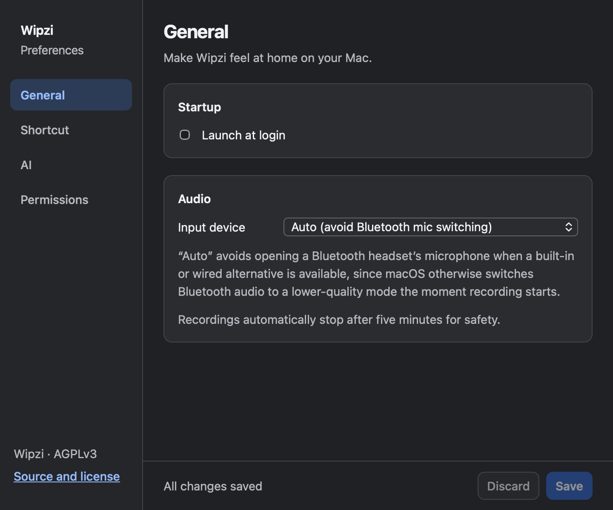

# Humhum

Humhum is a free, open-source macOS menu bar app for voice dictation. Hold a global shortcut, speak, and paste locally transcribed text into the active app.

**Installer beta: Apple Silicon Macs, macOS 13 or later, English transcription.** Download [Humhum v0.1.6 beta](https://github.com/kacheo/humhum/releases/tag/v0.1.6). Intel Macs are not yet supported.




Screenshots show the existing UI with synthetic state.

Humhum was previously named Wipzi. See [v0.1.6 beta verification](docs/v0.1.6-readiness.md).

## Install and first run

1. Download `Humhum_0.1.6_aarch64.dmg` and `SHA256SUMS.txt` from [the v0.1.6 beta release](https://github.com/kacheo/humhum/releases/tag/v0.1.6). The installer is Developer ID signed, notarized, and stapled. To verify the download, put both files in the same directory and run `shasum -a 256 -c SHA256SUMS.txt` there.
2. Open the DMG and drag Humhum into Applications. Quit older Humhum/Wipzi copies, eject the DMG, and open `/Applications/Humhum.app`.
3. Follow onboarding to grant Microphone, Accessibility, and Input Monitoring permissions. Select your shortcut; it is applied before the Try it step.
4. Download Base English (about 148 MB). Small English is optional (about 488 MB); allow additional free space for downloads and operation.

You can also build and launch Humhum from source using the instructions below.

Focus a text field in another app. Hold **Option+Shift+Space**, speak, and release to transcribe and paste. Escape cancels a recording. Recordings stop automatically after five minutes.

Humhum uses a new app identity and starts with fresh preferences, models, API keys, and permission grants. It does not import or remove Wipzi data. Quit Wipzi and disable its Launch at Login setting before using Humhum to avoid competing shortcuts.

Change the shortcut, input device, model, and cleanup mode in Preferences. The menu-bar menu opens Preferences and quits the app. Closing Preferences hides the window.

See [troubleshooting](docs/troubleshooting.md) for setup problems. This is a beta: review dictated text before sending or submitting it.

## Privacy and optional cleanup

Whisper transcription runs on your Mac. After a model is downloaded, raw transcription works offline. Model downloads contact Hugging Face and are checked against pinned SHA-256 hashes.

Cleanup is off by default:

- **None:** paste the raw local transcript.
- **Local Ollama:** send transcript text to your configured Ollama endpoint. Use a local endpoint to keep processing on your Mac.
- **Cloud API:** send transcript text, not audio, to OpenAI or Anthropic using your own key. Keys are stored in macOS Keychain. Provider terms, retention policies, and usage charges apply.

See [cleanup setup and local data removal](docs/troubleshooting.md). Never include private recordings, transcript text, or API keys in bug reports.

## Build and test

Install Node.js 24, Rust 1.88+ (stable recommended), Xcode Command Line Tools, CMake, and Python 3. On an Apple Silicon Mac:

```sh
git clone https://github.com/kacheo/humhum.git
cd humhum
npm ci
npm run tauri dev
```

Run checks separately:

```sh
npm test
python3 -m pip install -r scripts/requirements-test.txt
npm run test:release
npm run build
cargo test --manifest-path src-tauri/Cargo.toml --locked
```

`npm run tauri build` creates an unsigned development bundle. Signed releases use [the release guide](docs/release.md). No license key or payment is required to use Humhum.

## Contributing and security

See [CONTRIBUTING.md](CONTRIBUTING.md) for architecture, checks, and pull requests, and the [roadmap](docs/roadmap.md) for priorities. Report vulnerabilities privately as described in [SECURITY.md](SECURITY.md).

## License

Copyright © 2026 Kalon Cheong and contributors. Humhum is licensed under [AGPL-3.0-only](LICENSE). Release notes link to the exact source tag. Dependencies and downloaded models retain their own licenses; see [THIRD_PARTY_NOTICES.md](THIRD_PARTY_NOTICES.md).
